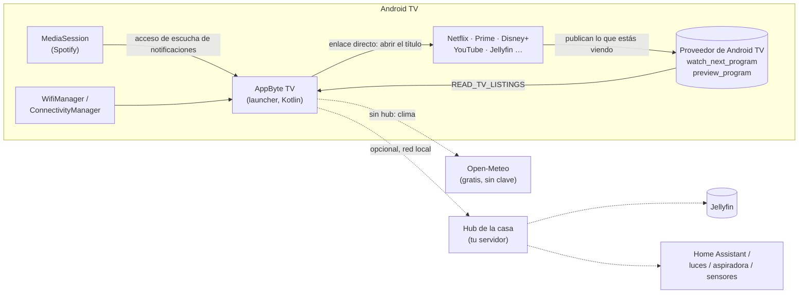

# AppByte TV

**Una pantalla de inicio rápida y bonita para Android TV, pensada para televisores viejos con poca memoria.**

AppByte TV es un *launcher* (la app de "Inicio") para Android TV. Reemplaza la pantalla de inicio de fábrica por una limpia que abre
en alrededor de un segundo en una TV con solo **1,4 GB de RAM**, muestra lo que estabas viendo en *todas* tus apps y,
si quieres, controla tu casa inteligente. No usa librerías de terceros: la única dependencia es `androidx.core`.

> 🇬🇧 [Read in English](README.md)

<p align="center">
  
</p>

## Contenido

- [Qué hace](#qué-hace) · [Capturas](#capturas) · [Inicio rápido](#inicio-rápido)
- [Cómo funciona](#cómo-funciona) · [Temas](#temas) · [Mapa del control remoto](#mapa-del-control-remoto)
- [Hub opcional](#hub-opcional-de-la-casa) · [Limpieza de la TV](#limpieza-de-la-tv-opcional)
- [Probado en](#probado-en) · [Limitaciones](#limitaciones-conocidas) · [Documentación](#documentación) · [Licencia](#licencia)

## Qué hace

| | |
|---|---|
| **Continuar viendo, entre apps** | Una sola fila mezcla lo que Netflix, Prime Video, Disney+, YouTube… publican en la base de datos de Android TV con tu progreso en Jellyfin. Al elegir una tarjeta la app se abre directamente en ese título. |
| **Una sola búsqueda** | Escribe una vez: busca en Jellyfin (vía el hub) y en los catálogos que publican tus apps; botones para YouTube y el Asistente de Google. |
| **Dos temas** | *Paisaje* (fotos que cambian con el amanecer/atardecer, tarjetas de vidrio) y *Abstracto* (estilo Apple TV: degradados de color que se mueven lento, tarjetas redondeadas, el foco eleva la tarjeta con un brillo). Un botón cambia de uno a otro. |
| **Fila de apps inteligente** | Tus apps favoritas primero, ordenadas por uso o a mano (mantén **OK** sobre una app para moverla). El resto en *Todas las apps*. |
| **Estado de un vistazo** | Fecha y hora, clima (icono animado), nombre de la red Wi-Fi, banda y velocidad del enlace. |
| **Mini reproductor** | Carátula, pausa/play y siguiente para Spotify; solo aparece mientras hay una sesión. |
| **Botón Ocultar** | Un clic oculta las filas y deja solo el fondo; otro clic las devuelve. |
| **Protector de pantalla propio** | Fondo en movimiento lento con un reloj grande que salta de esquina cada minuto (evita marcas en pantalla). |
| **Intro** | Una animación "AppByte TV" cada vez que la TV arranca o despierta. |
| **Animaciones** | Foco con rebote, tarjetas que entran en cascada, apps que se abren creciendo desde su tarjeta, modo noche que atenúa y calma la interfaz. |
| **Control de la casa (opcional)** | Con un hub: calidad del aire, luces, aspiradora, "modo cine", "dormir", página de estado. Ver [docs/HUB_API.md](docs/HUB_API.md). |
| **Liviano** | ~50 MB de RAM, sin desenfoque, animaciones en capas de GPU, fondos de 16 bits. |
| **Modo demo** | `--ez demo true` muestra datos inventados: sirve para tomar capturas sin filtrar nada personal. |

## Capturas

| Intro (arranque / despertar) | Panel lateral (IZQUIERDA desde la primera tarjeta de una fila) |
|---|---|
|  |  |

| Modo "Ocultar" | Búsqueda |
|---|---|
|  |  |

> Capturas en modo demo con el tema *Abstracto* (el tema *Paisaje* necesita fondos que pones tú; no se incluyen).

## Inicio rápido

Necesitas: una Android TV con **ADB por red** activado y un computador con `adb`, JDK 17 y el SDK de Android (Android Studio trae todo).

```bash
git clone https://github.com/dancrewzus/appbyte-tv.git && cd appbyte-tv/launcher
cp local.properties.example local.properties        # edita: tu ubicación, tu nombre… (todo es opcional)
./gradlew assembleFullDebug                          # -> app/build/outputs/apk/full/debug/app-full-debug.apk  (variantes: ver abajo)
cd .. && tools/install.sh 192.168.1.50               # instala en la TV (usa la IP de tu TV)
```

El launcher queda instalado y abierto, **pero al pulsar Inicio sigue ganando el de fábrica**. Es a propósito: pruébalo primero. Cuando estés conforme:

```bash
tools/install.sh 192.168.1.50 --make-home --screensaver    # desactiva el launcher de fábrica y usa nuestro protector
tools/debloat.sh 192.168.1.50 launcher-on                  # deshacer, cuando quieras
```

Guía completa (activar opciones de desarrollador, cómo encontrar la actividad de TV en vivo, reversa, problemas frecuentes): [docs/INSTALL.md](docs/INSTALL.md) *(en inglés)*.

## Cómo funciona



* **"Continuar viendo" no es magia.** Las apps de Android TV publican entradas *Watch Next* (y tarjetas de "seguir viendo" en su propio canal) en una base de datos del sistema. El launcher de Google la lee; AppByte TV lee los mismos datos con el permiso `READ_TV_LISTINGS`, que Android concede solo. Detalle en [docs/ARCHITECTURE.md](docs/ARCHITECTURE.md#continue-watching-and-search).
* **Sin hub todo funciona**, salvo las tarjetas de la casa, los botones de luces y la fila de Jellyfin. El clima viene de Open-Meteo con la latitud/longitud que configures.
* La interfaz son `View`s de Android creadas en código (sin XML, sin Compose, sin librerías). Todos los tamaños están escritos en "píxeles de 1080p" y se escalan con un solo ayudante, así que se ve igual en cualquier resolución.

## Temas

| | *Paisaje* | *Abstracto* |
|---|---|---|
| Fondo | foto según la hora (día / atardecer / noche, de tus propios `bg_*.jpg`) | tres manchas de color enormes y suaves que derivan lentamente, teñidas según la hora |
| Tarjetas | vidrio esmerilado, anillo blanco al enfocar | más redondas, sin borde; el foco eleva la tarjeta con un brillo blanco |
| Pestañas | píldora translúcida | pestaña enfocada = píldora blanca con texto oscuro |
| Requiere | fondos en `assets/` (no incluidos) | nada |

Se cambia con el botón de paleta del panel lateral y se recuerda. Sin fondos instalados solo está disponible *Abstracto*.

## Mapa del control remoto

| Dónde | Tecla | Qué pasa |
|---|---|---|
| En cualquier parte | **Atrás** | sale del panel lateral / cierra la pantalla |
| Primera tarjeta de *Continuar viendo*, *Tus apps* o *Aire* | **Izquierda** | entra al panel lateral |
| Panel lateral | **Derecha** o **Atrás** | vuelve a donde estabas |
| *Continuar viendo* | **Arriba** | barra superior |
| Una app de *Tus apps* | **mantener OK** | menú: mover a la izquierda / derecha / orden automático |
| Panel lateral → ojo | **OK** | ocultar / mostrar las filas |
| Panel lateral → paleta | **OK** | cambiar de tema |

## Variantes de compilación

| Variante | Permisos | Úsala cuando |
|---|---|---|
| `full` | todos: ver todas las apps, acceso a notificaciones (mini reproductor), ubicación (nombre del Wi-Fi) | tu TV deja instalarla (ADB, o Play Protect no se opone) |
| `loc` | `lite` + ubicación (muestra el nombre del Wi-Fi; la app lo pide una vez) | **la opción habitual sin ADB** |
| `lite` | ninguno de los sensibles | Play Protect también bloquea `loc` |

Algunas TVs (una Sony Bravia de 2017, por ejemplo) muestran *"app bloqueada para proteger el equipo"* con `full`, porque junta permisos sensibles, y sin botón de "instalar de todos modos". Las variantes `lite`/`loc` sí instalan **si van firmadas con una clave normal (no la de depuración)**: compila una APK de lanzamiento (`./gradlew assembleLocRelease`) y fírmala con `tools/sign-apk.sh`. Detalles y toda la ruta sin ADB: [docs/INSTALL.md](docs/INSTALL.md#installing-without-adb-play-protect-blocks-it) *(en inglés)*.

## Hub opcional de la casa

AppByte TV puede hablar con un pequeño servicio HTTP de tu red local (el **hub**) para datos de domótica. El contrato son 6 endpoints y está en [docs/HUB_API.md](docs/HUB_API.md). Para probarlo sin montar nada, usa el sustituto incluido:

```bash
python3 tools/mock-hub/server.py            # sirve datos inventados en :8190 y alterna luces en memoria
# compila con appbyte.hubUrl=http://<ip-de-tu-computador>:8190
```

## Limpieza de la TV (opcional)

Muchas TVs traen más de 100 paquetes en segundo plano que se comen la RAM. `tools/debloat.sh` quita paquetes **de forma reversible** (`pm uninstall -k --user 0`; nada sale de la imagen del sistema) a partir de una lista que revisas antes; `measure` muestra RAM, swap y tiempo de arranque del launcher antes/después. Hay listas de ejemplo para una TV Philips en `tools/tiers/`. Ver [docs/DEBLOAT.md](docs/DEBLOAT.md).

## Probado en

| TV | Android | RAM | Resultado |
|---|---|---|---|
| Philips 50PUD7906 | 11 (API 30) | 1,4 GB | todo lo descrito aquí (ADB por red, launcher de fábrica desactivado) |
| Sony BRAVIA XBR-55X805E | 9 (API 28) | — | funciona con la variante `loc` firmada con una clave que no sea la de depuración; `full` la bloquea Play Protect; sin ADB por red no se puede desactivar el launcher de fábrica |

`minSdk` es 26 (Android 8), por lo que las TVs de 2017 en adelante deberían funcionar, pero solo se probó la de arriba. Los reportes de otros modelos son muy bienvenidos (abre un *issue* con marca, modelo y versión de Android).

## Limitaciones conocidas

* **La interfaz está en español** (los textos están en el código, aún no en `strings.xml`). Traducirla es un buen primer aporte.
* En TVs que no dejan desactivar el launcher de fábrica (sin ADB), **Inicio sigue abriendo el del fabricante**; AppByte TV queda como una app que abres desde la lista.
* Con el launcher de fábrica **desactivado**, la búsqueda global de Google y sus fichas de títulos no se abren (viven dentro de ese launcher); AppByte TV tiene su propia búsqueda.
* "Continuar viendo" solo muestra lo que cada app decide publicar. Algunas no publican nada.
* El mini reproductor soporta solo Spotify.
* Android oculta el *nombre* del Wi-Fi si la ubicación de la TV está apagada (`install.sh --location`); banda y velocidad funcionan sin eso.
* El logo y el sonido de arranque de tu TV vienen del firmware y no se cambian sin root; AppByte TV reproduce su propia intro justo después.
* Las apps de terceros no pueden leer la foto de tu cuenta de Google; el avatar es una letra, o una foto servida por el hub.
* Las listas de limpieza son por marca/modelo: revisa cada nombre de paquete antes de aplicarlas en otra TV.

## Documentación

| Documento | Contenido |
|---|---|
| [docs/INSTALL.md](docs/INSTALL.md) | activar ADB en la TV, compilar, instalar, dejarlo como Inicio, reversa, solución de problemas |
| [docs/CONFIGURATION.md](docs/CONFIGURATION.md) | cada ajuste, permiso, preferencia, formato de fondos/logos, parámetros de prueba |
| [docs/ARCHITECTURE.md](docs/ARCHITECTURE.md) | mapa del código, flujos de datos, modelo de foco, temas, decisiones de rendimiento (con diagramas) |
| [docs/HUB_API.md](docs/HUB_API.md) | el contrato del hub opcional, con ejemplos `curl` |
| [docs/DEBLOAT.md](docs/DEBLOAT.md) | limpieza segura y reversible de una TV |
| [CONTRIBUTING.md](CONTRIBUTING.md) | cómo compilar, probar y proponer cambios |

*(La documentación técnica está en inglés; este README es la versión completa en español.)*

## Licencia

[MIT](LICENSE). Netflix, Prime Video, Disney+, YouTube, Spotify, Jellyfin y Philips son marcas de sus dueños; este proyecto no está afiliado a ellos y no incluye ninguno de sus logos.
