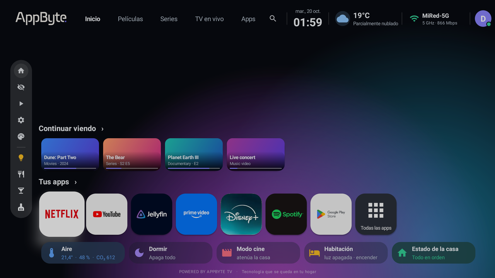
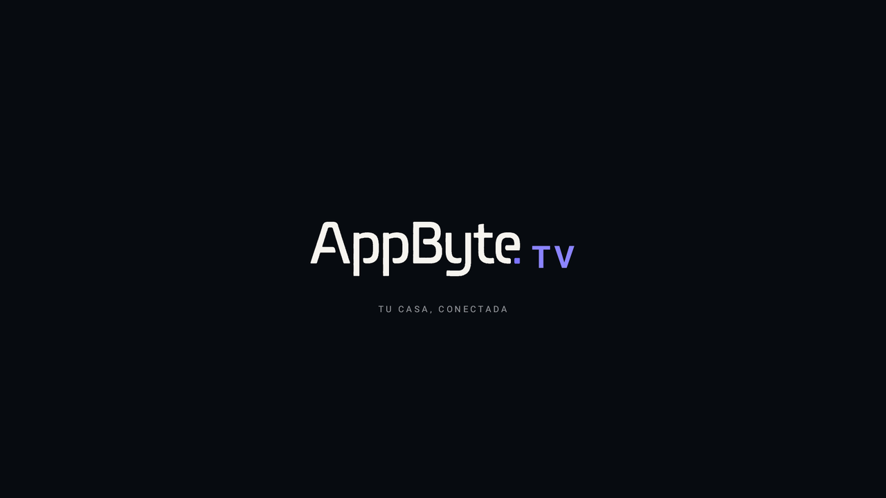
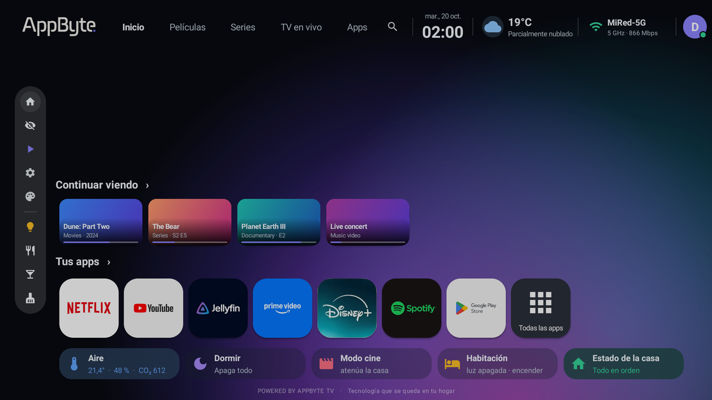
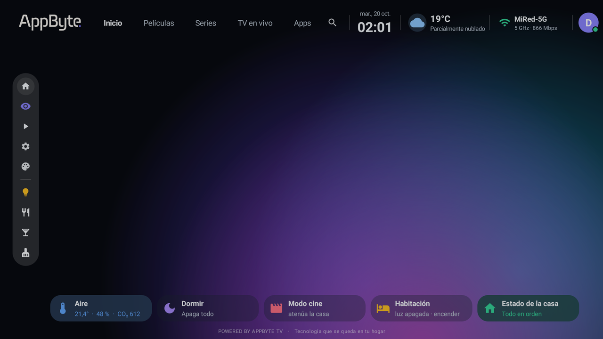
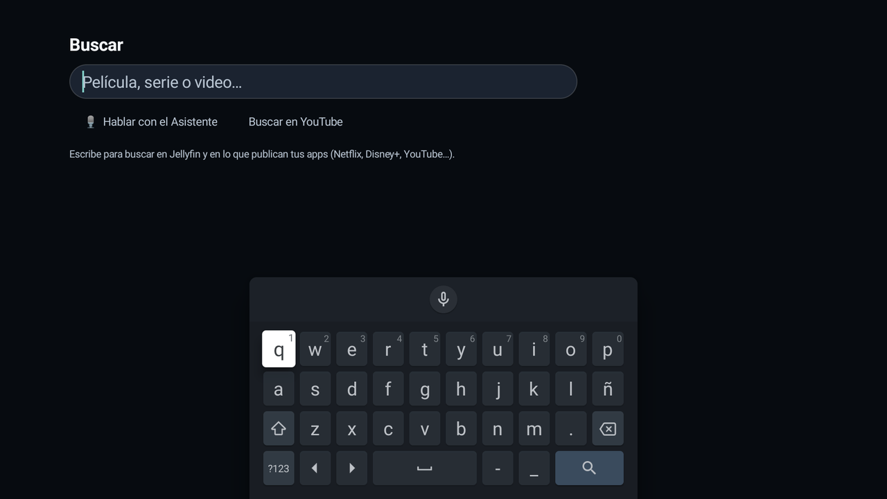
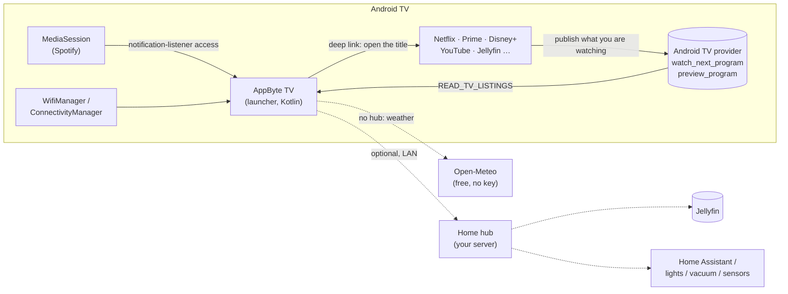

# AppByte TV

**A fast, good-looking replacement home screen for Android TV — built to run on old, low-memory TVs.**

AppByte TV is a launcher (the "Home" app) for Android TV. It replaces the stock home screen with a clean one that
opens in about a second on a TV with only **1.4 GB of RAM**, shows what you were watching across *all* your apps,
and (optionally) controls your smart home. It has no third-party libraries — the only dependency is `androidx.core`.

> 🇪🇸 [Leer en español](README.es.md)

<p align="center">
  
</p>

## Contents

- [Features](#features)
- [Screenshots](#screenshots)
- [Quick start](#quick-start)
- [How it works](#how-it-works)
- [Themes](#themes)
- [Remote control map](#remote-control-map)
- [Optional home hub](#optional-home-hub)
- [Cleaning up the TV (optional)](#cleaning-up-the-tv-optional)
- [Tested on](#tested-on)
- [Known limitations](#known-limitations)
- [Documentation](#documentation)
- [Contributing](#contributing) · [License](#license)

## Features

| | |
|---|---|
| **Continue watching, across apps** | One row mixes what Netflix, Prime Video, Disney+, YouTube… publish to Android TV's own database with your Jellyfin progress. Click a card and the app opens on that title. |
| **One search** | Type once: finds titles in Jellyfin (through the hub) and in the catalogs your apps publish; buttons for YouTube and the Google Assistant. |
| **Two themes** | *Paisaje* (photo wallpapers that change with sunrise/sunset, frosted-glass cards) and *Abstracto* (Apple TV-like: slowly drifting colour gradients, soft rounded cards, focus lifts the card with a glow). One button switches. |
| **Smart apps row** | Your favourite apps first, ordered by how much you use them or by hand (hold **OK** on an app to move it). Everything else under *Todas las apps*. |
| **Status at a glance** | Date and time, weather (animated icon), Wi-Fi network name, band and link speed. |
| **Mini music player** | Cover, play/pause and next for Spotify, shown only while there is a session. |
| **Hide button** | One press hides the rows and leaves just the wallpaper; press again to bring them back. |
| **Own screensaver** | Slow-moving wallpaper with a big clock that hops corner every minute (no burn-in). |
| **Intro animation** | An "AppByte TV" intro plays every time the TV boots or wakes. |
| **Animations** | Springy focus, cascade entrance of the cards, apps open growing out of their card, night mode that dims and calms the UI. |
| **Home control (optional)** | With a hub: room air quality, lights, vacuum, "cinema mode", "sleep", house status page. See [docs/HUB_API.md](docs/HUB_API.md). |
| **Tiny and fast** | ~50 MB of RAM, no blur, GPU-layer animations, 16-bit (RGB_565) wallpapers. |
| **Demo mode** | `--ez demo true` shows made-up data: take screenshots without leaking anything personal. |

## Screenshots

| Intro (boot / wake) | Side panel (LEFT from the first card of a row) |
|---|---|
|  |  |

| "Hide" mode | Search |
|---|---|
|  |  |

> The screenshots are taken in demo mode with the *Abstracto* theme (the *Paisaje* theme needs wallpapers you provide; none are shipped).

## Quick start

You need: an Android TV with **ADB over network** enabled, a computer with `adb` and JDK 17 + the Android SDK (Android Studio brings both).

```bash
git clone https://github.com/dancrewzus/appbyte-tv.git && cd appbyte-tv/launcher
cp local.properties.example local.properties        # edit: your location, name, ... (all optional)
./gradlew assembleDebug                              # -> app/build/outputs/apk/debug/app-debug.apk
cd .. && tools/install.sh 192.168.1.50               # install on the TV (use your TV's IP)
```

The launcher is now installed and started, **but the stock launcher still wins when you press Home**. That is intentional:
try it first. When you are happy:

```bash
tools/install.sh 192.168.1.50 --make-home --screensaver    # disable the stock launcher, use our screensaver
tools/debloat.sh 192.168.1.50 launcher-on                  # undo, any time
```

Full walk-through (enabling developer options, finding your TV's live-TV activity, rollback, troubleshooting): [docs/INSTALL.md](docs/INSTALL.md).

## How it works



* **"Continue watching" is not magic.** Android TV apps publish *Watch Next* entries (and "keep watching" cards in their own channel) to a system database. Google's launcher reads it; AppByte TV reads the same data with the `READ_TV_LISTINGS` permission, which Android grants automatically. See [docs/ARCHITECTURE.md](docs/ARCHITECTURE.md#continue-watching-and-search).
* **Without a hub everything still works** except the house cards, the light buttons and the Jellyfin row. Weather comes from Open-Meteo for the latitude/longitude you set.
* The UI is plain Android `View`s built in code (no XML layouts, no Compose, no libraries) so it stays light. All sizes are written in "1080p pixels" and scaled by one helper, so it looks the same on any TV resolution.

Deeper: [docs/ARCHITECTURE.md](docs/ARCHITECTURE.md).

## Themes

| | *Paisaje* | *Abstracto* |
|---|---|---|
| Background | photo by time of day (day / sunset / night, from your own `bg_*.jpg`) | three huge soft colour spots drifting slowly, tinted by time of day |
| Cards | frosted glass, white focus ring | rounder, no border; focus lifts the card with a white glow |
| Top tabs | translucent pill | focused tab = solid white pill with dark text |
| Needs | wallpapers in `assets/` (not included) | nothing |

Switch with the palette button in the side panel. The choice is remembered. With no wallpapers installed only *Abstracto* is available.

## Remote control map

| Where | Key | What happens |
|---|---|---|
| Anywhere | **Back** | leaves the side panel / closes the screen |
| First card of *Continuar viendo*, *Tus apps* or *Aire* | **Left** | enters the side panel |
| Side panel | **Right** or **Back** | back to where you were |
| *Continuar viendo* | **Up** | top bar |
| An app in *Tus apps* | **hold OK** | menu: move left / move right / automatic order |
| Side panel → eye | **OK** | hide / show the rows |
| Side panel → palette | **OK** | switch theme |

## Optional home hub

AppByte TV can talk to a tiny HTTP service on your LAN (the **hub**) for smart-home data. The contract is 6 endpoints and is documented in [docs/HUB_API.md](docs/HUB_API.md). To try it with zero setup run the included stand-in:

```bash
python3 tools/mock-hub/server.py            # serves made-up data on :8190, toggles lights in memory
# build with appbyte.hubUrl=http://<your-computer-ip>:8190
```

## Cleaning up the TV (optional)

Many TVs ship with 100+ background packages that eat RAM. `tools/debloat.sh` removes packages **reversibly** (`pm uninstall -k --user 0`; nothing leaves the system image) from a list you review first; `measure` prints RAM, swap and launcher start time before/after. Example lists for a Philips TV are in `tools/tiers/`. See [docs/DEBLOAT.md](docs/DEBLOAT.md).

## Tested on

| TV | Android | RAM | Result |
|---|---|---|---|
| Philips 50PUD7906 | 11 (API 30) | 1.4 GB | everything in this README |

`minSdk` is 26 (Android 8), so 2017+ TVs should work, but only the TV above has been tested. Reports for other models are very welcome (open an issue with brand, model and Android version).

## Known limitations

* **The interface is in Spanish** (strings are in the code, not yet in `strings.xml`). Translating is a good first contribution.
* With the stock launcher **disabled**, Google's own global search and title pages do not open (they live inside that launcher); AppByte TV has its own search instead.
* "Continue watching" only shows what each app chooses to publish. Some apps publish nothing.
* The mini player supports Spotify only.
* The Wi-Fi *name* is hidden by Android unless the TV's location setting is on (`install.sh --location`); band and speed work without it.
* Your TV's boot logo and boot sound come from the firmware and cannot be changed without root; AppByte TV plays its own intro right after.
* Google account photos cannot be read by third-party apps; the avatar is a letter, or a picture served by the hub.
* Debloat lists are per brand/model: check every package name before applying them to another TV.

## Documentation

| Doc | What is inside |
|---|---|
| [docs/INSTALL.md](docs/INSTALL.md) | enabling ADB on the TV, building, installing, making it Home, rollback, troubleshooting |
| [docs/CONFIGURATION.md](docs/CONFIGURATION.md) | every setting, permission, preference, wallpaper/logo format, intent extras |
| [docs/ARCHITECTURE.md](docs/ARCHITECTURE.md) | code map, data flows, focus model, themes, performance decisions (with diagrams) |
| [docs/HUB_API.md](docs/HUB_API.md) | the optional hub contract, with `curl` examples |
| [docs/DEBLOAT.md](docs/DEBLOAT.md) | safe, reversible clean-up of a TV |
| [CONTRIBUTING.md](CONTRIBUTING.md) | how to build, test and send changes |

## Contributing

Issues and pull requests are welcome — see [CONTRIBUTING.md](CONTRIBUTING.md).

## License

[MIT](LICENSE). Netflix, Prime Video, Disney+, YouTube, Spotify, Jellyfin and Philips are trademarks of their owners; this project is not affiliated with them and ships none of their logos.
