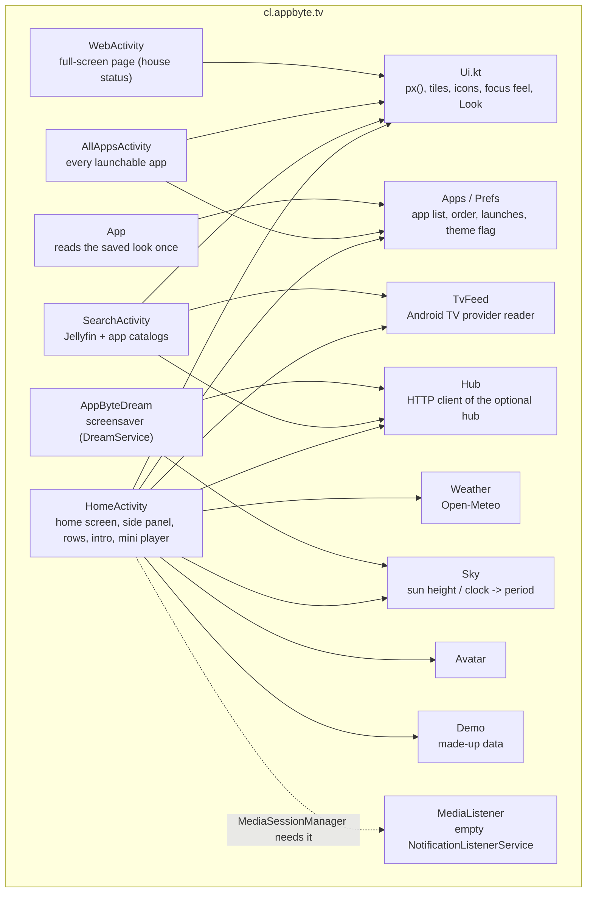
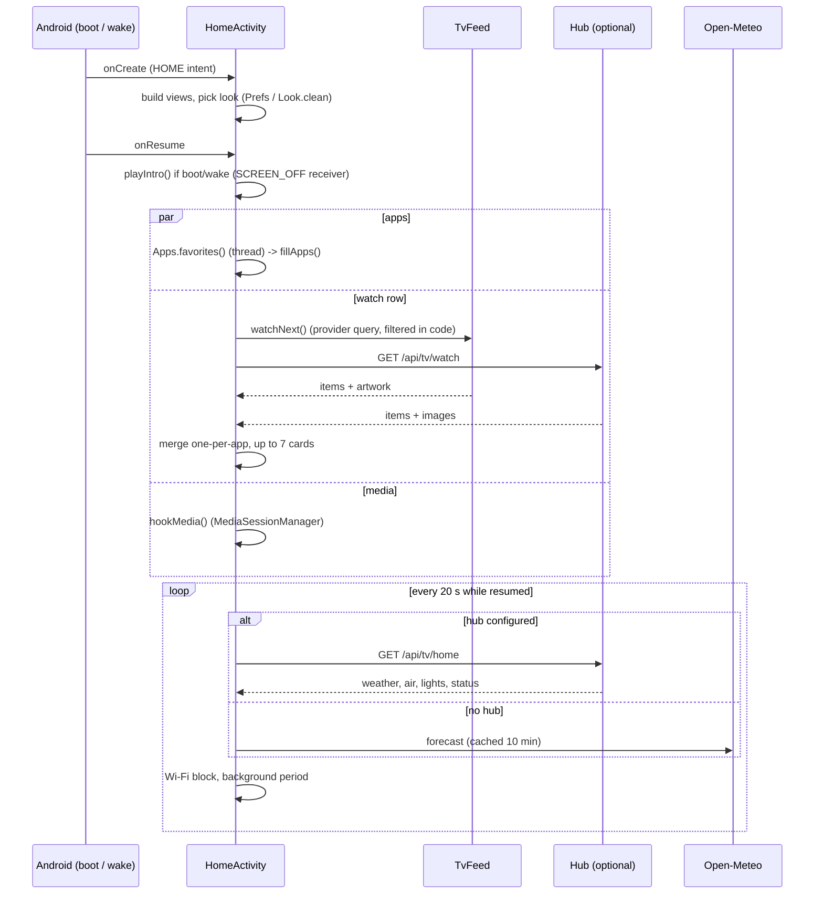
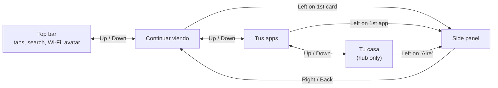

# Architecture

AppByte TV is one Android app (`cl.appbyte.tv`) written in Kotlin with **no libraries except `androidx.core`**. Everything is drawn from code with plain `View`s. This is deliberate: the target is a TV with ~1.4 GB of RAM where the stock launcher alone uses ~125 MB.

## Contents

- [Code map](#code-map)
- [Screen layout](#screen-layout)
- [Start-up and refresh](#start-up-and-refresh)
- [Continue watching and search](#continue-watching-and-search)
- [Focus model](#focus-model)
- [Themes](#themes)
- [Day / sunset / night](#day--sunset--night)
- [Intro, screensaver, night mode](#intro-screensaver-night-mode)
- [Performance decisions](#performance-decisions)
- [Where to change what](#where-to-change-what)

## Code map



| File | Responsibility |
|---|---|
| `HomeActivity.kt` | The home screen. Builds the whole view tree in `onCreate`; polls every 20 s; owns the intro, side panel, hide mode, theme switch, mini player. |
| `Ui.kt` | Shared building blocks: `px()` / `sizePx()` (1080p units), `GlassTile`, `AppTile`, `HouseTile`, `WatchCard`, `RoundIcon`, `TopTab`, `focusPop()`, `staggerIn()`, colours, the `Look` flags. |
| `TvFeed.kt` | Reads `content://android.media.tv/watch_next_program` and `preview_program`; decodes artwork; opens items through the intent each app published. |
| `Hub.kt` | `HttpURLConnection` client for the optional hub (`state()`, `watch()`, `search()`, `image()`, `action()`). |
| `Weather.kt` | Open-Meteo call (used only without a hub). |
| `Sky.kt` | Solar elevation (NOAA approximation) → `DAY / SUNSET / NIGHT`; falls back to the clock without coordinates. |
| `Apps.kt` | Launchable apps, favourites order, `Prefs` (theme, manual order, launch counters), Jellyfin deep link. |
| `SearchActivity.kt` | Search screen. |
| `AppByteDream.kt` | Screensaver. |
| `WebActivity.kt` | A `WebView` in a full-screen activity, for the hub's status page. |
| `Avatar.kt`, `Demo.kt`, `App.kt`, `MediaListener.kt` | small helpers |

## Screen layout

All sizes are written as if the screen were 1920×1080 and converted by one function (`px()`), so the layout is the same on 720p, 1080p or 4K panels (Android TV usually reports a 1080p UI at density 320).

```
┌──────────────────────────────────────────────────────────────────────────────────────────────┐
│ AppByte  Inicio Películas Series [TV en vivo] Apps  🔍 │ date/time │ ☁ 19°C │ ⌁ Wi-Fi │  (A) │  top bar
├──┬───────────────────────────────────────────────────────────────────────────────────────────┤
│☰ │                                                                                           │
│  │                       wallpaper / gradient  (nothing on top: it is the point)            │
│side│                                                                                         │
│panel  Continuar viendo ›                                                                     │
│  │  [card][card][card][card][card]                          ← up to 7, 224×126               │
│  │  Tus apps ›                                                                               │
│  │  [app][app][app][app][app][app][app][ Todas las apps ]   ← 160×160                         │
│  │  [Aire][Dormir][Modo cine][Habitación][Estado de la casa] ← only with a hub                │
│  │              POWERED BY APPBYTE TV · phrase of the day                                     │
└──┴───────────────────────────────────────────────────────────────────────────────────────────┘
```

The side panel (home, hide, Jellyfin, settings, theme, lights/vacuum with a hub, mini player) is vertically centred on the *screen*, not on the free area.

## Start-up and refresh



| What | When | Notes |
|---|---|---|
| Hub state / weather / Wi-Fi | every 20 s while the home is on screen | stops in `onPause` |
| Apps row | every `onResume` | rebuilt so installs/uninstalls show up |
| Continue-watching row | every `onResume`; skipped if nothing changed | signature of titles + progress |
| Mini player | live (`MediaController.Callback`) | |
| Intro | first start and each wake | `SCREEN_OFF` sets a flag, `onResume` plays it |

## Continue watching and search

Android TV has a system database (the *TV provider*) where apps publish what to show on the home screen. AppByte TV reads two tables:

| Table | Who uses it | What it contains |
|---|---|---|
| `watch_next_program` | Prime Video, Jellyfin, … | "Watch Next": items to resume, with `last_playback_position_millis` and `duration_millis` (→ the progress bar) |
| `preview_program` | Netflix, Disney+, YouTube, … | cards in the app's own channel. Netflix marks the ones to resume with the description **"Seguir viendo …"**; AppByte TV treats those (and any with playback progress) as "continue watching" |

Details that cost time to find out:

* Reading needs only `READ_TV_LISTINGS`, which Android grants at install. The *write-everything* permission `ACCESS_ALL_EPG_DATA` is system-only and is **not** needed.
* The provider **rejects `WHERE` clauses** on these tables ("Selection not allowed"), so the app reads the rows and filters in Kotlin.
* Every row carries `intent_uri`: the app's own deep link. `TvFeed.open()` parses it with `Intent.parseUri` and starts it, so a card opens the show, not the app's home.
* The row shows **one card per app in turn** (round-robin) so a chatty app does not push the others out.
* Jellyfin comes from the hub (richer: progress, posters) and its provider rows are ignored to avoid duplicates. Jellyfin's start activity understands the extra `ItemId`, so a card opens that movie directly.

Search (`SearchActivity`) types once, debounces 450 ms, then queries the hub (`/api/tv/search`) and filters the same two provider tables (case-insensitive `contains`). Buttons launch the Assistant (`ACTION_ASSIST`) and YouTube (`ACTION_SEARCH` to the YouTube TV package).

## Focus model

The TV is driven with a D-pad, so focus is the whole interaction. The side panel is **outside the normal focus path**: its items are not focusable until you enter it, so pressing Left/Right in a row never lands there by accident.



Implementation: `railEntry(view)` installs an `OnKeyListener` on the first card of each row; `enterRail()` sets all panel items focusable and focuses the first; `leaveRail()` reverses it and returns focus to the remembered view. The last focused view's `tag` is stored by a global focus listener so coming back from an app restores the focus where you left it.

## Themes

`Look.clean` (a process-wide flag, read from `Prefs` in `App.onCreate`) switches the look. Switching saves the flag and calls `recreate()`, so every view is rebuilt in the other style; `Look.skipIntro` avoids replaying the intro.

| Piece | *Paisaje* (`clean = false`) | *Abstracto* (`clean = true`) |
|---|---|---|
| Background | `ImageView` with `bg_<period>_<n>.jpg` from assets + black scrims top and bottom | `blobs()`: 3 `View`s with a radial `GradientDrawable`, 1700 px wide, as hardware layers; only their `translationX/Y` animate (26–46 s, reverse) |
| `GlassTile` | translucent fill + 2 px edge; focus: 4 px white ring, scale 1.06 | corner radius +12; no stroke; focus: scale 1.1 + `translationZ` lift + white spot shadow (opaque tiles only: a translucent tile would show its own shadow) |
| `TopTab` | translucent pill | focused = white pill with dark text; current = bold |
| Side panel | dark rounded panel with border | light glass, no border |

`focusPop()` gives both themes the springy (`OvershootInterpolator`) focus feel. If no `bg_*` asset exists, `Look.hasPhotos` is false and *Abstracto* is forced.

## Day / sunset / night

`Sky.period()` decides which wallpaper (or which gradient colours) to use:

* with `appbyte.lat/lon`: solar elevation `> 12°` → day, `> -4°` → sunset (dawn and dusk), else night — independent of the TV's own timezone, which is often wrong on TVs;
* without coordinates: the local hour (8–17 day, 6–7 and 18–19 sunset, else night).

Test any period without waiting: `adb shell am start -S -n cl.appbyte.tv/.HomeActivity --es period day|sunset|night`.

## Intro, screensaver, night mode

* **Intro** — an opaque overlay with the logo (overshoot scale), "TV" sliding in and the tagline, ~2 s, then it fades while the rows enter in cascade. Triggered on first `onResume` and after every `ACTION_SCREEN_OFF`.
* **Screensaver** — `AppByteDream` is a `DreamService`. Registered with `settings put secure screensaver_components cl.appbyte.tv/.AppByteDream`. The clock block moves to another corner every minute against burn-in; the wallpaper does a 60 s slow zoom.
* **Night mode** — when the period is *night* a 20 % black overlay dims the UI and the weather icon stops moving.

## Performance decisions

| Decision | Why |
|---|---|
| no libraries (no Compose, Glide, Retrofit…) | install size and RAM; ~50 MB of PSS on the test TV |
| views built in code, no XML layouts | fewer allocations, one place to read |
| **no blur** | blur is far too heavy for a 1.4 GB TV; "glass" is translucent fill + edge |
| animations are `ViewPropertyAnimator` / `ObjectAnimator` on `translation*`, `alpha`, `scale*` of GPU layers | no per-frame drawing and no layout passes; the gradient blobs never redraw |
| bitmaps decoded `RGB_565` and down-sampled to ≈ 700 px | half the memory; posters are small |
| 20 s polling only while resumed | nothing runs in the background |
| `px()` in 1080p units, text via `sizePx()` | Android's `sp` doubles on a density-320 TV; one conversion keeps layouts honest |
| small in-memory image caches that clear at 30–60 entries | bounded memory |

## Where to change what

| I want to… | Edit |
|---|---|
| change the apps in the home row | `PREFERRED` in `Apps.kt` |
| add a card to the house row | `HomeActivity.onCreate` (`HouseTile`) + an action name in your hub |
| change colours, sizes, focus feel | `Ui.kt` |
| change the gradient colours | `recolorBlobs()` in `HomeActivity.kt` |
| add a language | strings are literals in the Kotlin files today; see [CONTRIBUTING](../CONTRIBUTING.md) |
| support another music app in the mini player | `pickSession()` in `HomeActivity.kt` (filters on the Spotify package) |
| change the day/sunset/night thresholds | `Sky.kt` |
