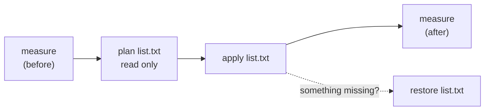

# Cleaning up a TV (optional, reversible)

Android TVs from big brands ship with 100+ packages: store front-ends, telemetry, ad platforms, demo modes, registration wizards. On a 1.4 GB TV they keep RAM busy and make everything slower. `tools/debloat.sh` removes a list of packages **for the current user only**.

## Why it is safe

* It runs `pm uninstall -k --user 0 <package>`: the APK **stays in the system image** (`-k` keeps data) and is merely hidden for user 0.
* `cmd package install-existing <package>` brings it back — `tools/debloat.sh <ip> restore <list>` does that for a whole list.
* A factory reset also restores everything.
* Nothing is touched without an explicit action word; `plan` only reads.



## Procedure

```bash
tools/debloat.sh 192.168.1.50 measure                        # save this output
tools/debloat.sh 192.168.1.50 plan  tools/tiers/tier1-safe.txt
tools/debloat.sh 192.168.1.50 apply tools/tiers/tier1-safe.txt
tools/debloat.sh 192.168.1.50 measure                        # compare
```

Then, one line at a time if you wish, tier 2 (each line is a feature you may miss).

## Writing your own list

1. List what the TV has: `adb shell pm list packages -s` (system) and `-3` (yours).
2. Search for what a package is: `adb shell dumpsys package <pkg> | head -40`, or look it up. When in doubt **leave it**.
3. Put one package per line; `#` starts a comment:

```
com.vendor.demomode      # store demo mode
com.vendor.telemetry     # vendor logging
```

## What not to remove

* The package that provides your **launcher** until you have tested AppByte TV (use `launcher-off`/`launcher-on` for that, not `apply`).
* **Google Play services** (`com.google.android.gms`) and the framework packages: apps break.
* The **Assistant** (`com.google.android.katniss`) if you use the remote's voice button.
* Anything under `com.android.*` or `android` unless you know exactly what it is.
* The TV tuner/input framework if you watch live TV (on Philips: `org.droidtv.*` tuner and `com.mediatek.*` packages).

## Measured example (Philips 50PUD7906, 1.4 GB)

Free RAM went from 623 MB to about 700 MB and the launcher's cold start was ~1.0 s (the stock launcher took 1.2–1.7 s). A modest improvement: the TV still has 1.4 GB, and the system itself uses most of it. The lists in `tools/tiers/` are that TV's; **package names differ on every brand and model.**
