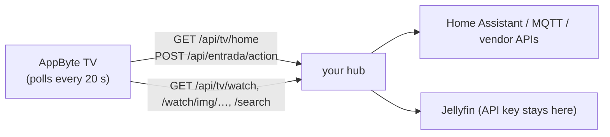

# The optional home hub

The launcher works without it. If you set `appbyte.hubUrl`, it talks to a small HTTP service in your LAN — the **hub** — to show smart-home data and your Jellyfin progress. You write the hub; the contract below is all the launcher needs. A stand-in with made-up data is included: [`tools/mock-hub/server.py`](../tools/mock-hub/server.py).



**Rules of thumb**

* Plain HTTP on your LAN, **no authentication** in the launcher. Keep the hub on a trusted network and never expose it to the internet.
* Keep API keys (Jellyfin, Home Assistant) **in the hub**; the TV never sees them. That is why images are proxied through `/api/tv/watch/img/<id>`.
* Timeouts are short (3 s connect, 5–6 s read). Answer fast; cache upstream calls.
* Every field is optional: missing values simply show "—".

## Endpoints

| Method & path | Used by | Purpose |
|---|---|---|
| `GET /api/tv/home` | home screen | everything the house cards need, in one answer |
| `POST /api/entrada/action` | buttons | run an action |
| `GET /api/tv/watch` | continue-watching row | Jellyfin items |
| `GET /api/tv/watch/img/<id>` | row, search | poster/thumbnail for an item |
| `GET /api/tv/search?q=` | search screen | Jellyfin matches |
| `GET /api/tv/avatar?name=<n>&own=1` | avatar | the profile picture, or `404` |
| `GET /` | *Estado de la casa* card | any HTML page; it opens full screen in a `WebView` |

### `GET /api/tv/home`

```json
{
  "weather": { "state": "partlycloudy", "temp": 19.0 },
  "air":     { "temp": 21.4, "hum": 48.0, "co2": 612.0, "pm25": 6.0 },
  "people":  [ { "name": "Ana", "present": true } ],
  "door":    { "open": false },
  "cams":    { "up": 4, "total": 4 },
  "office":  { "effective": "off", "live": false },
  "attention": [],
  "mimir": {
    "away": false, "vacation": false, "movie": false,
    "lights": { "lampara": "on", "comedor": "off", "bar": "off", "habitacion": "off" },
    "tv": {},
    "robot": { "state": "docked", "battery": 100 }
  }
}
```

(`mimir` is the historical name of the object holding house automation state; keep it.)

| Field | Shown as |
|---|---|
| `weather.state` | icon + word. Home-Assistant states: `sunny`, `clear-night`, `partlycloudy`, `cloudy`, `rainy`, `pouring`, `lightning`, `fog`, `snowy`, `windy` |
| `weather.temp` | °C next to the icon |
| `air.temp/hum/co2` | line of the *Aire* card |
| `mimir.lights.*` | lamp / dining / bar buttons light up when `"on"`; the *Habitación* card |
| `mimir.robot.state` | vacuum button turns green when it contains `clean` |
| `mimir.movie` | *Modo cine* card shows "activado · salir" |
| `mimir.away` / `vacation` | status card says "Modo ausente" / "Modo vacaciones" |
| `attention` | list of problem names; the status card says "N avisos · ver detalle" (empty = "Todo en orden") |
| `door`, `cams`, `people`, `office` | parsed, currently not displayed (kept for future cards) |

### `POST /api/entrada/action`

Body `{"a": "<action>"}` → any 2xx means success (the launcher shows a green ✓ banner). Actions the launcher sends:

| Action | Sent by |
|---|---|
| `dormir` | *Dormir* card ("Apaga todo") |
| `cine_on` / `cine_off` | *Modo cine* card (toggle, based on `mimir.movie`) |
| `toggle:habitacion` | *Habitación* card |
| `toggle:lampara`, `toggle:comedor`, `toggle:bar` | side-panel light buttons |
| `toggle:robot` | side-panel vacuum button |

Names are only strings: map them to whatever your automation does.

### `GET /api/tv/watch`

```json
{ "title": "Continuar viendo",
  "items": [ { "id": "4a6361a6d41fe7f2ddbaa434edf0e860", "title": "Moana", "sub": "2016", "progress": 0.43, "image": "4a6361a6d41fe7f2ddbaa434edf0e860" } ] }
```

* `title` is `"Continuar viendo"` for in-progress items (they join the row) or something else, e.g. `"Novedades"`, when you only have recent additions (shown only if nothing else is in progress).
* `id` is the Jellyfin item id (32 hex chars): the launcher opens it with `ItemId`.
* `progress` 0–1. `image` is the id passed to `/api/tv/watch/img/<image>`.

### `GET /api/tv/watch/img/<id>`

Returns an image (JPEG/PNG), ≈ 480 px wide. `404` if none.

### `GET /api/tv/search?q=moa`

```json
{ "items": [ { "id": "…", "title": "Moana", "sub": "2016", "type": "Movie" } ] }
```
Return `[]` for queries shorter than 2 characters.

### `GET /api/tv/avatar?name=ana&own=1`

A JPEG picture the family chose for that person, or `404` (the launcher then shows the initial). It is cached on the TV.

## A minimal hub

```bash
python3 tools/mock-hub/server.py          # :8190
curl -s localhost:8190/api/tv/home | python3 -m json.tool
curl -s -XPOST localhost:8190/api/entrada/action -d '{"a":"toggle:bar"}'
```

Build the launcher with `appbyte.hubUrl=http://<computer-ip>:8190` and the TV shows the made-up house; light buttons really toggle (in memory) and the server prints the actions.

## Wiring a real one (ideas)

* **Home Assistant**: a 60-line FastAPI/Flask service that calls HA's REST API (`/api/states/…`, `/api/services/light/toggle`) with a long-lived token kept in an environment variable, and returns the JSON above.
* **Jellyfin**: `GET /Users/<id>/Items/Resume`, `GET /Items/Latest`, `GET /Search/Hints`, `GET /Items/<id>/Images/Primary` with the header `X-Emby-Token: <key>`.
* **Firewall**: allow the TV to reach only the hub's port.
