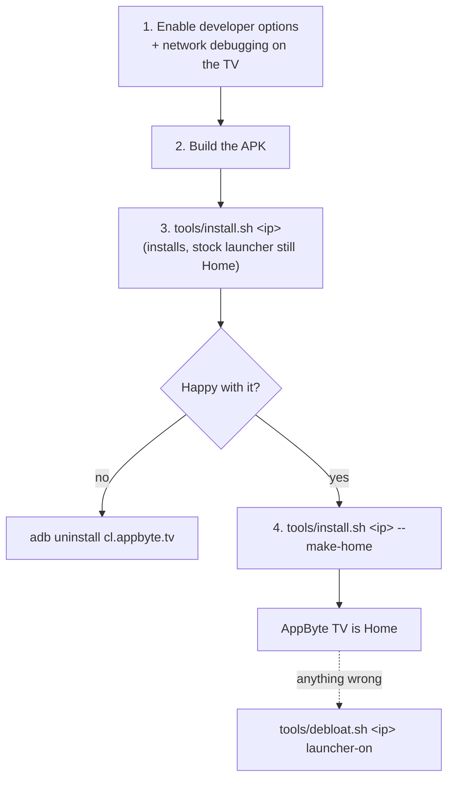

# Installing AppByte TV

This guide takes you from a stock Android TV to AppByte TV as the Home screen, and shows how to get back.



## 1. Prepare the TV

1. **Settings → Device Preferences → About**: press **Build** seven times ("You are now a developer").
2. **Settings → Device Preferences → Developer options**: turn on **USB debugging** and, if present, **Network debugging** / *ADB debugging over network*.
   * Some TVs only expose the network option when "USB debugging" is on; some need a reboot.
3. Note the TV's IP address (**Settings → Network**). Give it a fixed address in your router if you can.
4. From your computer, the first connection asks the TV to **Allow USB debugging?** — accept it (tick *Always allow*).

```bash
adb connect 192.168.1.50:5555      # use your TV's IP
adb devices                         # should list 192.168.1.50:5555  device
```

If `connect` is refused, the TV is not listening on 5555: re-check step 2, reboot the TV, and make sure the computer and TV are on the same network/VLAN.

## 2. Build

Requirements: JDK 17 and the Android SDK (platform 35). Android Studio provides both; otherwise install them and set `ANDROID_HOME`.

```bash
cd launcher
cp local.properties.example local.properties    # then edit (see docs/CONFIGURATION.md)
./gradlew assembleFullDebug
# result: launcher/app/build/outputs/apk/full/debug/app-full-debug.apk   (~3.6 MB with wallpapers, ~1.3 MB without)
```

On macOS with Android Studio's bundled JDK:
`JAVA_HOME="/Applications/Android Studio.app/Contents/jbr/Contents/Home" ./gradlew assembleFullDebug`

Other variants: `assembleLocDebug`, `assembleLiteDebug` (see [Build variants](../README.md#build-variants)).

The Gradle wrapper (`gradlew`) downloads Gradle 8.14.3 by itself.

### Settings worth setting now

Put them in `launcher/local.properties` **before** building (they are compiled into the app):

| Key | Why |
|---|---|
| `appbyte.lat`, `appbyte.lon` | weather, and exact sunrise/sunset for the day/sunset/night look. Without them the clock decides and there is no weather. |
| `appbyte.userName` | the letter in the avatar circle |
| `appbyte.liveTv` | the activity of your TV's live-TV app (shows the "TV en vivo" tab). See below. |
| `appbyte.hubUrl` | only if you run a hub ([HUB_API.md](HUB_API.md)) |

#### Finding your TV's live-TV activity

```bash
adb -s 192.168.1.50:5555 shell pm list packages | grep -i -E "tv|livetv|tuner"
adb -s 192.168.1.50:5555 shell cmd package query-activities --brief -a android.intent.action.MAIN -c android.intent.category.LEANBACK_LAUNCHER
```

Open live TV on the TV, then: `adb shell dumpsys activity activities | grep mResumedActivity` prints `package/Activity` — that is the value for `appbyte.liveTv`. (Philips example: `com.mediatek.wwtv.tvcenter/com.mediatek.wwtv.tvcenter.nav.TurnkeyUiMainActivity`.)

## 3. Install and try it

```bash
tools/install.sh 192.168.1.50
```

It installs the APK, grants the permissions that can be granted from ADB, allows the media listener (for the mini player) and starts the launcher. Pressing **Home** still opens the stock launcher: that is your safety net while you test. Open AppByte TV from the apps list (or run the last command again).

Options:

| Flag | Effect |
|---|---|
| `--location` | turns the TV's location setting on, so Android lets the app read the Wi-Fi **name**. Optional; it is a privacy setting, leave it off if you prefer ("Wi-Fi" is shown instead). |
| `--screensaver` | uses the AppByte TV screensaver after the TV's idle time (default 5 min) |
| `--make-home` | disables the stock launcher so **Home** opens AppByte TV (next section) |

## 4. Make it the Home screen

Android TVs rank the vendor launcher above any app, so an ordinary app cannot take over the Home button. The reliable way is to disable the stock launcher for the user:

```bash
tools/install.sh 192.168.1.50 --make-home       # or:  tools/debloat.sh 192.168.1.50 launcher-off
```

> ⚠️ **Do this only with a version you tested.** If AppByte TV crashed at start with the stock launcher disabled, you would see a grey screen. Recovery is one command from your computer: `tools/debloat.sh <ip> launcher-on`.

The stock launcher package is `com.google.android.tvlauncher` on Google-certified TVs. Other brands differ (`adb shell cmd package resolve-activity --brief -a android.intent.action.MAIN -c android.intent.category.HOME`); pass the package as the third argument: `tools/debloat.sh <ip> launcher-off <package>`.

## Installing without ADB (Play Protect blocks it)

Some TVs never open ADB over the network (a 2017 Sony Bravia on Android 9 did not: no network-debugging option, closed port 5555, USB ports are host-only). You can still install and use AppByte TV:

1. **Build a lower-risk variant.** Play Protect refused the `full` APK ("this app may request access to sensitive data", no *install anyway* button) because it combines notification access, location and all-apps visibility. Build `loc` (adds back the location permission, so the Wi-Fi name shows) or, if that is blocked too, `lite`:
   ```bash
   cd launcher && ./gradlew assembleLocRelease          # app/build/outputs/apk/loc/release/app-loc-release-unsigned.apk
   ```
2. **Sign it with a normal key** (not the debug key):
   ```bash
   keytool -genkeypair -v -keystore my.jks -alias appbyte -keyalg RSA -keysize 2048 -validity 10000     # once
   tools/sign-apk.sh launcher/app/build/outputs/apk/loc/release/app-loc-release-unsigned.apk appbyte-loc.apk my.jks appbyte
   ```
   On the tested Sony the debug-signed builds were refused and the release-signed `lite`/`loc` installed.
3. **Copy it to the TV:** a FAT32/exFAT USB stick plus a file manager app from the TV's Play Store (File Commander, X-plore), or *Send Files to TV* from a phone on the same network. Allow "unknown sources" for that file manager when asked.
4. **What you lose without ADB:** the mini music player (notification access), `pm grant`-style set-up (the app asks for location itself on first start, once), measuring RAM, debloating by list, and **disabling the stock launcher** — on the Sony that button does not exist ("Android TV Home" is protected), so Home keeps opening the vendor's launcher. Open AppByte TV from the apps list, set it as the screensaver (Settings → Device preferences → Screen saver), or put a small Android TV box with ADB on the HDMI port and make *that* the home.

> The same applies if you publish the app on Google Play: it needs `targetSdk` 34 or higher, a Play developer account and a justification for sensitive permissions; the `lite`/`loc` variants are the ones to start from.

## Updating

Rebuild and run `tools/install.sh <ip>` again (`install -r` keeps your preferences).

## Uninstalling

```bash
tools/debloat.sh 192.168.1.50 launcher-on          # bring the stock launcher back first
adb -s 192.168.1.50:5555 uninstall cl.appbyte.tv
```

## Troubleshooting

| Symptom | Fix |
|---|---|
| Grey screen after `launcher-off` | `tools/debloat.sh <ip> launcher-on` (or `adb shell pm enable com.google.android.tvlauncher`) |
| `adb connect` hangs / refused | network debugging is off, TV asleep, or different VLAN/subnet |
| Wi-Fi block says only "Wi-Fi" | Android hides the SSID without location: `install.sh <ip> --location` |
| No mini player | notification access missing: `adb shell cmd notification allow_listener cl.appbyte.tv/cl.appbyte.tv.MediaListener`; it also only appears while Spotify has a session |
| "Continuar viendo" is empty | the apps have published nothing yet (watch something first); check `adb shell content query --uri content://android.media.tv/watch_next_program` shows rows |
| Only one theme available | there are no `bg_*.jpg` in `assets/`; add them (see [CONFIGURATION.md](CONFIGURATION.md#wallpapers-and-logos)) or use *Abstracto* |
| Home cards missing | no hub configured (`appbyte.hubUrl` empty) — by design |
| Weather says "sin ubicación" | set `appbyte.lat` / `appbyte.lon` and rebuild |
| Build fails: SDK not found | create `launcher/local.properties` with `sdk.dir=/path/to/Android/sdk` |
| Looks wrong at night in photos | night mode dims the UI on purpose after sunset (see ARCHITECTURE) |

## Trying it without a TV hub / without touching your TV

Use the Android TV emulator from Android Studio (API 30+), `adb install` the APK, and run it in demo mode:

```bash
adb shell am start -S -n cl.appbyte.tv/.HomeActivity --ez demo true
```

Demo mode shows a made-up house, weather and Wi-Fi and never touches the network.
